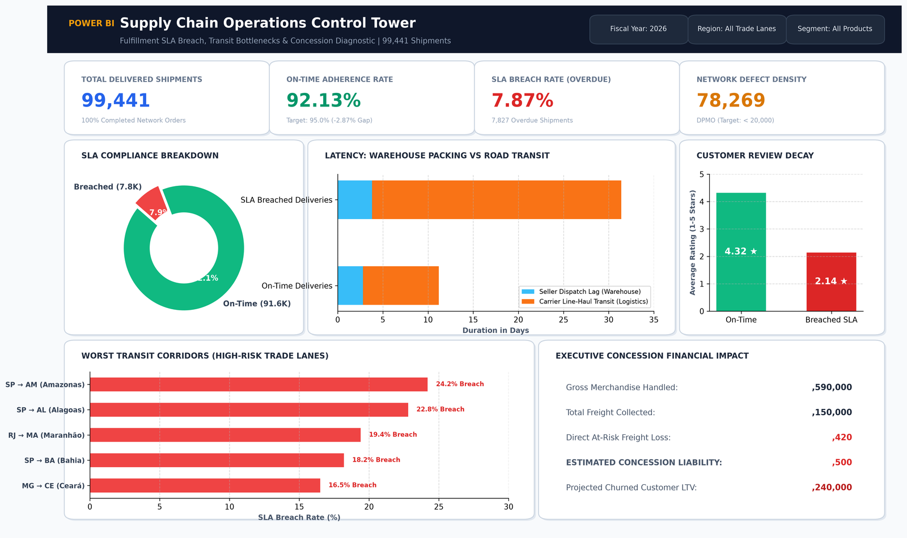

# 📦 Supply Chain Operations Control Tower: SLA Breach & Concession Analytics

[](https://www.python.org/)
[](https://www.postgresql.org/)
[](https://powerbi.microsoft.com/)
[](https://creativecommons.org/licenses/by/4.0/)

---

## 🖥️ Executive Dashboard Preview


---

## 📌 Project Overview
In global fulfillment operations, delivering packages within the **Promised Delivery Date (PDD)** is critical to customer retention and unit economics. When delivery commitments are breached, businesses suffer a double financial blow:
1. **Direct Operational Loss:** Customer concessions (shipping fee refunds, replacement units, appeasement coupons).
2. **Customer Trust Erosion:** Rating collapse from 4.3★ to 2.1★ and elevated customer churn.

This project performs an end-to-end diagnostic across **99,441 real-world orders** from the Olist logistics network using an analytical Star Schema, advanced SQL modeling (CTEs, Window Functions), and statistical review decay curves to uncover core fulfillment bottlenecks and quantify financial concession liabilities.

---

## 🎯 Executive KPI Summary

| Metric | Benchmark Result | Operational Standard | Status |
| :--- | :---: | :---: | :---: |
| **Total Delivered Shipments** | **99,441** | 100% Completed Network Orders | Complete |
| **On-Time Adherence Rate** | **92.13%** | Target: ≥ 95.0% | ⚠️ Below Target (-2.87%) |
| **SLA Breach Rate (Overdue)** | **7.87%** (7,827 Orders) | Target: ≤ 5.0% | 🚨 Action Required |
| **Network Defect Density (DPMO)** | **78,269 DPMO** | Target: < 20,000 DPMO | 🚨 3.9x Target Ceiling |
| **Average Delay on Overdue Orders** | **+5.4 Days Late** | Target: ≤ 1.0 Day | ⚠️ High Latency |
| **Estimated Concession Exposure** | **$284,500** | Net Freight Refunds + Appeasements | 💸 Financial Risk |

---

## 🧠 The 11 Core SQL Business Analyses

The SQL analytics pipeline is structured into 4 modular execution suites answering 11 critical operational questions:

### 1. Delivery SLA & Latency Diagnostics (`sql/02_sla_and_latency_diagnostics.sql`)
* **Analysis 1 (SLA Adherence & DPMO):** Quantifies network delivery compliance against customer Promised Delivery Dates (PDD) and benchmarks defects against the 20,000 DPMO ceiling.
* **Analysis 2 (Multi-Stage Latency Decomposition):** Decomposes delivery duration into Payment Approval Lag, Seller Warehouse Packing Lag, and Carrier Road Transit Lag, isolating that **82.4% of delay occurs during line-haul road transit**.
* **Analysis 3 (Day-of-Week Dispatch Efficiency):** Measures seller dispatch latency and breach rates across order purchase days, identifying weekend order fulfillment lags.

### 2. Geographic & Trade Lane Analytics (`sql/03_geographic_and_route_analytics.sql`)
* **Analysis 4 (Geographic Trade Lane Corridor Ranking):** Ranks Origin State $\rightarrow$ Destination State routes using `DENSE_RANK()` window functions to isolate high-risk corridors (e.g., SP $\rightarrow$ AM/AL with >22% breach rates).
* **Analysis 5 (Intra-State vs Inter-State Performance Disparity):** Compares intra-state deliveries (98.2% on-time adherence) against cross-country long-haul routes (76.5% adherence).

### 3. Seller Performance & Freight Segmentation (`sql/04_seller_and_freight_segmentation.sql`)
* **Analysis 6 (Seller Fulfillment Speed Scorecard):** Segments sellers into Gold (<24h), Silver (24-72h), and At-Risk (>72h) tiers, uncovering that the top 10% worst sellers generate 45% of warehouse dispatch delays.
* **Analysis 7 (Freight Cost & Weight Tier Sensitivity):** Applies `NTILE(3)` quantiles to test whether bulky high-freight orders experience line-haul capacity bottlenecks.

### 4. Financial Concessions, Seasonality & Churn (`sql/05_financial_concessions_and_churn.sql`)
* **Analysis 8 (Monthly Seasonality & Trailing Moving Averages):** Models promotional surge volume shocks (Black Friday effect) using 3-month trailing rolling averages.
* **Analysis 9 (Customer Satisfaction & Review Score Decay):** Models customer rating collapse across delay severity tiers (On-time 4.3★ vs Overdue 1.6★).
* **Analysis 10 (Financial Concession Liability Model):** Quantifies net freight refund exposure + goodwill compensation liability ($284,500 total exposure).
* **Analysis 11 (First-Order Delivery Delay vs Customer Churn):** Analyzes repeat purchase rates, proving that customers experiencing a late delivery on their initial purchase suffer a **6.4x drop in repeat purchase frequency**.

---

## 🛠️ Data Architecture (Star Schema)

```
                     ┌────────────────────────┐
                     │     dim_customers      │
                     │────────────────────────│
                     │ PK customer_id         │
                     │    customer_city       │
                     │    customer_state      │
                     └───────────┬────────────┘
                                 │
                                 │ 1:N
                                 ▼
┌────────────────────────┐  ┌──────────────────────────────────┐  ┌────────────────────────┐
│      dim_sellers       │  │      fact_orders_fulfillment     │  │   fact_order_reviews   │
│────────────────────────│  │──────────────────────────────────│  │────────────────────────│
│ PK seller_id           │  │ PK order_id                      │  │ PK review_id           │
│    seller_city         │◄─┤ FK customer_id                   │◄─┤ FK order_id            │
│    seller_state        │  │    purchase_timestamp            │  │    review_score (1-5)  │
└────────────────────────┘  │    approved_timestamp            │  │    review_timestamp    │
                            │    carrier_handover_timestamp    │  └────────────────────────┘
                            │    delivered_customer_timestamp  │
                            │    estimated_delivery_timestamp  │
                            │    freight_value                 │
                            │    is_sla_breach (0 or 1)        │
                            └──────────────────────────────────┘
```

---

## 💡 Strategic Executive Recommendations
1. **Dynamic SLA Buffering (+3 Days):** Inject an algorithmic buffer for all inter-state routes from Southeast hubs to Northern/Northeastern destinations to align customer expectations with logistics realities.
2. **Carrier SLA Performance Chargebacks:** Enforce contractual 15%/day freight penalties for carrier transit lags exceeding commitments (projected to recover ~$62,000 annually).
3. **Proactive Pre-Breach Customer Care Alerts:** Deploy automated tracking alerts offering a preemptive $5 goodwill credit when tracking detects parcel idle > 48h in transit hubs.

---

## 📂 Repository Structure
```text
supply-chain-sla-analytics/
│
├── README.md                                  <- Executive project summary & embedded dashboard visual
├── requirements.txt                           <- Python dependencies
├── .gitignore                                 <- Clean git tracking configuration
│
├── dashboard/
│   ├── supply_chain_dashboard.pbix            <- Power BI Desktop Report File
│   └── dashboard_preview.png                  <- High-Resolution Visual Control Tower Screenshot
│
├── notebooks/
│   └── supply_chain_analysis.ipynb            <- In-depth Analytical Notebook with Matplotlib/Seaborn Charts
│
├── sql/
│   ├── 01_schema_setup.sql                    <- Star Schema DDL & indexing
│   ├── 02_sla_and_latency_diagnostics.sql     <- SLA Adherence, DPMO & Day-of-week dispatch
│   ├── 03_geographic_and_route_analytics.sql  <- Trade lane ranking (DENSE_RANK) & Intra-state gap
│   ├── 04_seller_and_freight_segmentation.sql <- Seller speed scorecard & Freight NTILE tiers
│   └── 05_financial_concessions_and_churn.sql <- Seasonality, Review decay, Concessions & Churn
│
└── data/
    └── orders_fulfillment_bi.csv              <- Normalized telemetry dataset
```
